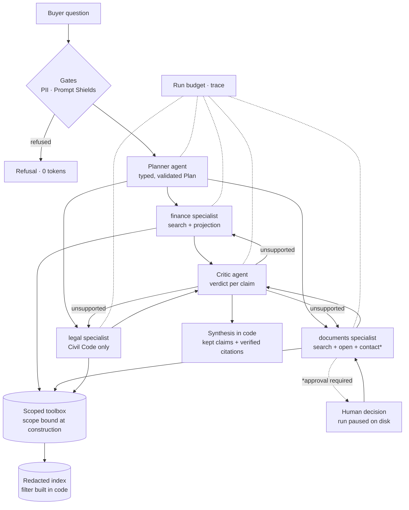

# condo-agents

[](https://github.com/waland1510/condo-agents/actions/workflows/ci.yml)

A multi-agent system for condominium due diligence, built on .NET 10 and the
Microsoft Agent Framework. It exists to answer one question with code rather
than slides: **what does it take to let a model drive control flow without
letting it own any security or correctness property?**

A buyer uploads a building's documents (bylaws, AGM minutes, financial
statements, a reserve-fund study, mostly in French) and asks whether the
purchase is safe. A planner agent decomposes the question, specialist agents
answer each part through tools that carry their access scope with them, a
critic agent checks every claim against the evidence and sends weak work
back once, and a human approves anything that leaves the system. Everything
runs offline on in-memory fakes; Azure is a configuration switch.



## Five-minute reading guide

1. [docs/adr/0002](docs/adr/0002-scope-lives-in-tools-not-in-prompts.md):
   why the retrieval boundary is a value bound into each tool, never a
   prompt or a tool argument. Then
   [ScopedToolbox.cs](src/CondoAgents.Agents/Tools/ScopedToolbox.cs) and the
   contract test that proves no tool exposes the boundary.
2. [docs/adr/0005](docs/adr/0005-budgets-and-gates-outside-the-model-loop.md):
   budgets under the function-calling loop, gates before the first model
   call, citations resolved against what was actually retrieved.
   [AgentFactory.cs](src/CondoAgents.Agents/Runtime/AgentFactory.cs) is the
   whole mechanism.
3. [docs/adr/0006](docs/adr/0006-planner-specialists-critic.md) and
   [DueDiligenceOrchestrator.cs](src/CondoAgents.Agents/Orchestration/DueDiligenceOrchestrator.cs):
   the model plans and calls tools; the orchestrator decides what runs,
   what is kept and when to stop for a human.
4. [docs/adr/0007](docs/adr/0007-human-in-the-loop-via-framework-approvals.md):
   an irreversible tool pauses the run, the session is serialized to disk,
   and a different process resumes it after the decision.
5. [evals/results/latest.md](evals/results/latest.md): eight trajectory
   cases graded on the run record, not on prose, and
   [evals/results/azure-20261020.md](evals/results/azure-20261020.md): the
   same cases against `gpt-5-mini`, six of eight passing, with the two
   cost failures explained in ADR 9.
   [docs/adr/0008](docs/adr/0008-trajectory-evals-as-a-ci-gate.md) records
   the defect the first run caught.

The other records: [0001](docs/adr/0001-record-architecture-decisions.md)
(why ADRs), [0003](docs/adr/0003-synthetic-corpus-with-declared-seeds.md)
(a fictional building whose traps are declared in `data/seeds.json`),
[0004](docs/adr/0004-attest-then-index.md) (screen, attest, then index;
roles fail closed).

## Run it

```bash
dotnet test --solution CondoAgents.slnx                      # 72 tests, no network
dotnet run --project src/CondoAgents.Evals                   # trajectory evals, writes evals/results/
dotnet run --project src/CondoAgents.Cli -- ask jardins-plateau "Is this condo safe to buy overall?"
dotnet run --project src/CondoAgents.Api                     # http://localhost:5027 — ask, watch the trajectory, approve or reject
dotnet run --project src/CondoAgents.Mcp -- --building jardins-plateau   # MCP server over stdio
```

The page served by the API starts a run in the background and polls it:
the plan, every model and tool call as it is recorded, the critic's
verdicts, pending approvals with approve and reject buttons, and the final
answer with citations and dropped claims. The same data is available as
JSON: `POST /buildings/{id}/runs`, `GET /runs/{id}`,
`POST /runs/{id}/approvals/{id}`. The CLI prints the same trajectory to the
terminal and, for a paused run, the `approve` command that resumes it.

The MCP server exposes the same scoped tools plus `ask_due_diligence` to
Claude Desktop, Copilot or any MCP client. The building is a server
argument; no tool takes a scope from the client.

Outside `Development` the API refuses to boot on fakes
(`Ai:RequireRealDependencies`), so a half-configured deployment fails
loudly instead of serving canned answers behind a healthy probe.

## Fake mode and Azure mode

Everything above the client interfaces is the same code in both modes. In
fake mode the model, retriever, PII detector and role adjudicator are
deterministic stand-ins
([ScriptedChatClient](src/CondoAgents.Agents/Fakes/ScriptedChatClient.cs),
[FakePlanner](src/CondoAgents.Agents/Fakes/FakePlanner.cs),
[FakeCritic](src/CondoAgents.Agents/Fakes/FakeCritic.cs),
[InMemoryRetrievalClient](src/CondoAgents.Clients/Fakes/InMemoryRetrievalClient.cs)):
the fake model searches with the question's words and quotes what it gets
back, so answers read like excerpts, and every test and eval is
deterministic.

Azure mode ([ADR 9](docs/adr/0009-real-azure-clients-behind-the-same-interfaces.md))
uses Foundry `gpt-5-mini` and `text-embedding-3-large`, a push-mode AI
Search index, AI Language PII detection, Content Safety Prompt Shields and
a model-backed role adjudicator. Entra credentials only, no keys. On a
shared Search service the app refuses any index name outside its own
`condo-agents-` prefix and creates no indexer, skillset or role assignment.
Document translation and cracking stay on fakes because both need blob
storage, which this app deliberately does not own.

```bash
export CONDO_EVAL_MODE=azure \
  Ai__FoundryEndpoint=https://<account>.services.ai.azure.com \
  Ai__ChatDeployment=gpt-5-mini Ai__EmbeddingDeployment=text-embedding-3-large \
  Ai__SearchEndpoint=https://<service>.search.windows.net Ai__SearchIndexName=condo-agents-chunks \
  Ai__LanguageEndpoint=https://<account>.cognitiveservices.azure.com \
  Ai__AzureCliSubscription="<subscription in the tenant that owns the resources>"
dotnet run --project src/CondoAgents.Evals            # writes evals/results/azure-<date>.md
```

The same variables with `Ai__UseAzure=true` switch the API; outside
`Development` it refuses to boot without them.

## Layout

```
src/CondoAgents.Domain      scope, scope filter, retrieval and citation types; no dependencies
src/CondoAgents.Clients     external-service abstractions and their fakes
src/CondoAgents.Corpus      manifest, chunker and loader for the checked-in documents
src/CondoAgents.Ingest      crack → translate → detect PII → adjudicate roles → redact → attest → index
src/CondoAgents.Agents      toolbox, budgets, trace, gates, agents, orchestrator, run store
src/CondoAgents.Evals       trajectory eval runner and report
src/CondoAgents.Api         minimal API: runs, approvals, health; fail-closed configuration
src/CondoAgents.Cli         prints a run as it happens
src/CondoAgents.Mcp         MCP server over stdio, scope bound at startup
tests/CondoAgents.Tests     xUnit v3 on Microsoft.Testing.Platform; the eval cases run here too
data/                       one fictional building (FR/EN) and the Civil Code reference corpus
evals/                      cases and committed results
docs/adr                    architecture decision records
```
